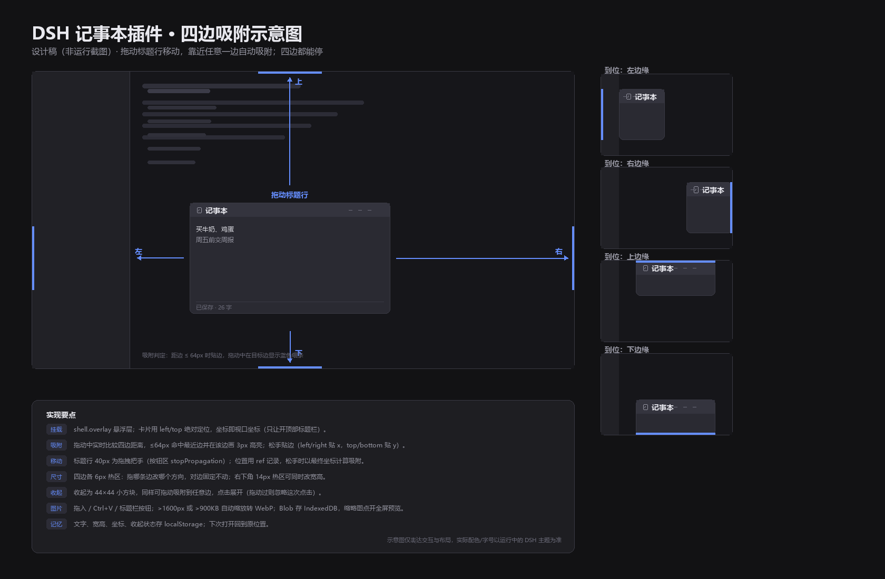

# DSH 记事本插件

`DSH`（DeepSeek Harness）Web 界面上的记事本，**两种摆放模式随时切换，同一个笔记两处共享**：

- **悬浮模式**（默认）：浮动卡片，拖动标题行移动，松手时靠近哪一边就吸附到哪一边——上、下、左、右四边都能停，拖出窗外则收成贴边把手。
- **停靠模式**：挂在框架真实布局的底栏（`shell.bottom`），上方三栏自动变矮，永不遮挡。

两个模式各有切换按钮：悬浮卡片标题栏的「停靠到底部」图标、底栏标题行的「脱离为悬浮卡片」图标。



> 上图为设计示意图，实际配色与字号以运行中的 DSH 主题为准。

## 功能

- **模式开关**：悬浮 ↔ 底部停靠一键切换，文字与图片完全共享，切换时正在进行的内容会先落盘，不会丢。
- **会话笔记**：会话行菜单「记一笔」直接给该会话记一条（已有内容则「打开会话笔记」），标题旁胶囊按钮在主笔记 / 会话笔记之间切换；对外暴露 `window.dshNotepad` 协议（列表 / 打开 / 订阅）供其它插件使用。
- **自动编号**：点工具栏「编号」把当前行变成 `1. ` 并开启自动编号——回车自动续号（`2.`、`3.`…），在空的编号项上回车则结束列表；支持 `1.` 与 `1)` 两种写法，缩进层级跟着保留。开启后工具栏会多出「重新编号」，一键把所有编号行按缩进分组重排成 1、2、3…（插入或删除过条目后特别好用）。
- **待办**：`- [ ]` / `- [x]` 行就是待办。点「待办」把当前行转成待办（已勾选则取消勾选），回车自动补下一条未勾选项；点「清单 n/m」弹出全部待办，点一行即可勾选/取消，源码里的标记同步改写，弹层底部还能「清除已完成」一次删掉所有勾选过的条目。
- **四边自动吸附**：拖动中实时比较到四边的距离，≤64px 时贴边（左/右贴 x，上/下贴 y），边框与圆角随之贴合。
- **待办面板**：点「清单 n/m」在正文上方展开可交互的待办面板——勾选框直接勾选（源码里的 `- [ ]`/`- [x]` 同步改写），点文字跳到笔记里对应那一行，面板头还能「清除已完成」。
- **图片链接（超链接式）**：每张缩略图带一个 `#abcd` 标签，点标签（或缩略图上的链接按钮）就在光标处插入 `[[img:abcd]]`；光标停在这个标记里时对应缩略图会高亮描边，再点标签则直接跳到已有的标记处。
- **复制图片**：缩略图悬停出现「复制」按钮，直接把图片字节写进剪贴板（环境不支持时退化为复制那串链接标记）。
- **自由移动**：标题行 40px 是拖拽把手，面板任意停在画面中间也行；位置随窗口夹紧，不会跑出可视区。
- **四边都能改尺寸**：上/下/左/右四条边各有一条 6px 热区——拖哪条边就改哪个方向，**对边保持不动**（所以拖左边/上边时面板会跟着走）；右下角另有 14px 热区可同时改宽高。260×180 起，上限随窗口自适应。
- **可以拖出窗口外**：把卡片往窗外一带（超出窗口 ≥40px），松手就收成贴着窗口边的一条把手（32px 厚），既不遮挡内容又随时能点回来；窗口内的四边吸附照常保留。
- **可收起**：标题行右上角收起按钮 → 变成 44×44 小方块，小方块本身也能拖动吸附到任意边，点一下展开（拖动过就不会误触展开）。
- **图片**：三个入口——标题栏图片按钮、直接拖进卡片、`Ctrl+V` 粘贴截图。超过 1600px 或 900KB 的自动缩放到 1600px 内并转 WebP。
- **图片查看**：右侧缩略图栏，点开全屏大图预览，`Esc` 或点背景关闭；缩略图右上角小叉删除。
- **自动保存**：文字 250ms 防抖存 `localStorage`，图片 Blob 存 `IndexedDB`（不占 `localStorage` 配额）；底部实时显示「已保存 / 保存中」与字数、图片数。
- **跟随主题**：颜色全部取自 `--dsw-alias-*` 主题变量；文案走 Client locale 服务，中英双语。

## 安装

### 从 GitHub 安装

```sh
dsh plugin --profile desktop add github:879745uhjun/dsh-notepad
```

装好后刷新 Web 页面即可看到卡片。

### 从本地目录安装

在已安装 DSH 的 profile 中用插件管理器安装本目录：

```
plugin_manager install_bundle  target: <本仓库路径>  enabled: true
```

插件会写入 profile 的 `node_modules` 并注册到 `dsh.profile.bundles`。装好后刷新 Web 页面即可看到卡片。

## 结构

| 文件 | 作用 |
| --- | --- |
| `package.json` | 包清单；`dsh.bundle.patch` 指向 `cordis.patch.yml`，`dsh.client` 声明 Web 端注入 |
| `cordis.patch.yml` | 向 profile 组合插入一行 `dsh-notepad` |
| `index.js` | host 半边，空实现（插件只需客户端渲染） |
| `client.js` | 客户端全部逻辑：同时注册 `shell.overlay`（悬浮卡片）与 `shell.bottom`（底部停靠）、共享状态、吸附、拖拽、图片、持久化、样式、locale |
| `locale/zh.json`、`locale/en.json` | Plugin Manager / 设置页读取的插件名称与描述 |
| `icon.svg` | 插件图标 |
| `design-schematic.png` | 本文档顶部的界面示意图 |

## 实现要点

- 两个槽同时注册：`shell.overlay`（悬浮）与 `shell.bottom`（停靠）。两个组件都常驻挂载，只渲染当前模式的那一个；`shell.bottom` 的内容渲染成 `null` 时不占高度（槽说明里写明的行为），所以切到悬浮模式底栏会完全让出空间。
- 文字与图片放在一个模块级 store 里（`subscribe` + `emit`），两处界面共享同一份数据；切模式时先把未落盘的内容同步写一次，避免丢字。
- 挂载在 **`shell.overlay`**：框架唯一的全窗口悬浮层，条目默认可点击（`pointer-events` 由每条自己开启）。
- 坐标直接用视口坐标（`left/top`），只把顶部标题栏那条 `--dsh-frame-chrome-top` 让开，避免压住可拖动窗口的标题栏。
- 拖动释放的判定是**纯函数** `resolveRelease(pos, size, box)`（4.5.1 从 `settle()` 拆出）：不读 DOM、不碰存储，
  返回 `{ kind: 'peek' | 'snap' | 'free', side, pos }`；`settle()` 只负责取几何 → 调它 → 应用结果。
- 吸附判定：`nearestEdge()` 比较四边距离取最近者，`snapTo()` 只改对应那一轴，另一轴保持原位——所以可以贴着上边缘靠右、也可以贴着左边靠下。平局按 left/right/top/bottom 顺序取先者。
- 拖动过程中位置写进 `useRef`，松手时用**最终坐标**判定吸附，避免 React 状态滞后导致的“差一点没吸上”。
- 边缘缩放时记录“对边”坐标（rightEdge/bottomEdge），每帧用 `对边 - 新尺寸` 反推新位置，缩到下限时对边不会漂移。
- 大图预览用 `position: fixed` 覆盖视口，不受卡片尺寸限制。
- 不引入任何 `@deepseek-ai/dsh-client-*` 包，React 由浏览器模块表提供，避免和宿主重复加载。

## 会话笔记（4.4.0）

主笔记之外，每个会话可以有一份自己的便签，用来「从会话里记一笔、之后能找到」。

**数据**
- 主文档仍是 `dsh-notepad:v1`，键名与结构不变；
- 会话笔记单独存 `dsh-notepad:session-notes:v1`：`{ [sessionId]: { text, updatedAt } }`；
- 读取容错：缺键 / 坏 JSON / 非对象 / 字段类型不对 → 当作空；写入 250ms 防抖（与主笔记一致）。

**用法**
1. 左侧会话列表 → 会话行「⋯」菜单 →「记一笔」（该会话已有内容时显示「打开会话笔记」）；
2. 记事本自动切到悬浮模式并展开，载入该会话的笔记，标题显示会话名；
3. 标题旁的胶囊按钮「主笔记 / 会话笔记」可随时来回切换；
4. 收起、贴边、拖出窗外都不影响两种笔记，各自独立保存。

**对外协议**（给 todos 等插件用，形状固定，不改名）

```js
window.dshNotepad = {
  version: 1,
  listSessionNotes(): Array<{ sessionId: string, updatedAt: number, preview: string }>,
  openSessionNote(sessionId: string): void,
  subscribe(listener: (sessionId: string) => void): () => void,
}
```

- `preview`：正文压成一行后的前 40 个字符；
- `subscribe`：写入落盘后通知，返回取消函数；
- 插件卸载/热更时只摘掉自己那个对象（不覆盖后来者，也不残留旧闭包）。

**降级**
- 会话行菜单位置不可用（宿主契约变化）→ 不注册菜单，记事本其余功能照常；
- localStorage 不可写（隐私模式 / 配额满）→ 会话笔记退化为内存态（当前输入不丢），并提示一次「会话笔记暂存内存」；
- 图片仍挂在主文档的附件库里：会话笔记只保存文字。

## 自检（4.5.0）

设置 → 插件 → 选中「记事本」→ 详情页里的「自检」区块。**只有点「运行自检」才跑**，挂载时不发任何探测；每条检查 2s 超时，失败显示原因；「复制结果」输出 Markdown 清单（`- [x] 标签 — 通过`）。

> 该座位在**每个**插件详情页都会渲染，所以组件会先比对页面 subject（`bundle.pkg.name` 或 `item.id` 去掉 `include:` 前缀）与包名 `dsh-notepad-card`，不是本插件就返回 `null`（4.5.2 起）。

| # | 检查项 | 判定 |
| --- | --- | --- |
| 1 | `window.dshNotepad` 协议 | `version === 1`，且 `listSessionNotes()` 可调用并返回数组 |
| 2 | localStorage 读写探针 | 写临时键 `dsh-notepad:selftest` → 读回 → 删除；任何一步抛错即失败 |
| 3 | 主笔记键可读 | `dsh-notepad:v1` 能被读取（存在或不存在都算通过） |
| 4 | 会话行菜单槽位 | `sidebar.workspaces.session.menu.item` 由宿主声明过（本插件的注册被接受即通过） |

- 入口：`plugins.detail.section`，`id: dsh-notepad.selftest`，`order: 90`，locale 用插件自己的命名空间
- 槽位不存在（宿主契约变化）时静默跳过，记事本本身不受影响
- 全程只读 + 一个自动清理的临时键，不读写用户笔记内容

## 测试

插件是浏览器模块（`window.__ModuleLoader__.load`），Node 里无法 import，所以测试**直接从 `client.js` 切出纯函数再求值**——测的就是要发布的那份源码，不存在测试副本与实现漂移。改名或删函数会让测试直接报错。

```bash
npm test        # 等价于 node --test "test/**/*.test.mjs"（Node 24 下不能传目录）
```

| 文件 | 覆盖 |
| --- | --- |
| `test/lines.test.mjs` | 编号续号 `continueLine`、`startTodo`、`toggleTodoAt`、`parseTodos`、`clearDoneTodos`、`renumberAll` |
| `test/snap.test.mjs` | 吸附取边 `nearestEdge`、`snapTo`（四边、阈值边界、平局、标题栏偏移） |
| `test/session-notes.test.mjs` | 会话笔记：坏数据容错、防抖与 flush、订阅通知/取消、列表排序与 preview、菜单文案（新建 / 打开已有）、存储失败退化为内存、会话键不写主文档键、全局对象安装/卸载/接管 |
| `test/extract-source.test.mjs` | 切片器自身：字符串/模板/注释里的 `{``}` 不会截断、缺函数报错、括号不配对报错 |
| `test/helpers/extract-source.mjs` | 按名字从源码切片并求值（引号与注释感知），缺函数即失败 |

共 41 个用例，零依赖。**故意把 `SNAP` 从 64 改成 40 时，正好两个阈值用例失败**，说明断言真的咬住了实现。

**没覆盖的部分**（都不是纯函数）：吸附的“松手释放判定” `settle()`（读 `livePos` ref 与 `bounds()` 里的 `innerWidth`／`getComputedStyle`）、拖拽与四边缩放的指针流程、光标相关逻辑（`selectionStart`／`scrollTop`）、IndexedDB 图片存储、canvas 压缩与 `ClipboardItem`、以及两个界面的 React 渲染。要测这些得引入 DOM/IDB 模拟环境；下一步最小改法是把 `settle()` 的决策抽成纯函数 `resolveRelease(pos, size, box)`。

## 工具：网络异常时的标准兜底推送路径

```bash
# 1) 先校验，不写远端（逐个比对 blob/tree，并报告远端分支是否已等于 HEAD）
node tools/push-via-api.mjs --repo <owner>/<name> --branch main --dry-run

# 2) 校验通过后再真推
node tools/push-via-api.mjs --repo <owner>/<name> --branch main
```

**什么时候用它**（本机 `github.com:443` 会间歇性被重置，`git push` 时通时断）：

| 情况 | 做法 |
| --- | --- |
| `git push` 正常成功 | 用 git，别用这个脚本 |
| `git push` 报 `Failed to connect` / `Recv failure: Connection was reset` / 超时，而 `gh auth status` 正常 | 用本脚本（它走 `api.github.com`） |
| 仓库是新建的空仓库 | 加 `--bootstrap`（REST 的 blob 接口在空仓库上返回 409） |
| 只想确认「远端到底是不是 HEAD」 | `--dry-run`，一条命令给出结论 |

行为与边界：

- 逐字节复现本地提交（blob / tree / parents / message / 作者与提交时间），**远端 sha 与本地 HEAD 完全相同**；任一处不匹配就在动 ref 之前中止
- 不内置 token：读 `GH_TOKEN` / `GITHUB_TOKEN`，否则调用 `gh auth token`（不落盘）
- 推送成功后会执行 `git update-ref refs/remotes/origin/<branch>`——REST API 不更新本地跟踪引用，不补这一步 `git status` 会一直显示幻影 `ahead N`，看起来像没推上去
- **判断「是否已推送」以远端 sha 为准**：`git ls-remote` 自己也可能被重置，此时用 `gh api repos/<owner>/<repo>/git/ref/heads/<branch>`；两者都取不到就明确说「未验证」，不要拿本地 `refs/remotes/*` 下结论

## 已知限制

- **真正的“浮在窗口外”做不到**：插件渲染的是网页内容，浏览器只能在自身窗口内绘制，框架还用 `overflow:hidden` 裁掉越界部分。要让界面浮在桌面上，得创建独立的原生窗口——那超出插件契约（需要改 DSH 本体）。所以这里提供的是“贴边收成把手”的近似方案：看上去挂在窗外，实际是窗口内最外侧的一条。
- 悬浮卡片会盖住下方内容（这是浮层的固有属性）；放在边缘、收成把手或小方块可把影响降到最小。
- `shell.overlay` 之上还有框架自己的遮罩（例如左侧栏抽屉展开时），那时卡片暂时点不到，关掉抽屉即可。
- `shell.bottom` 是单占位槽；停靠模式下它由本插件占用，若将来官方也往这一行注册内容，两者会互相顶替（后注册者优先）。
- **带 input 的 cordis inspect 调用当前不可用**（rc5 观察：`host` 与 `client` 两端均报 `"input" must be an object`；
  不带 `input` 的同类调用正常）。这是宿主侧工具声明与校验不一致，与本插件无关——核验槽位与协议请改用
  插件详情页的「自检」区块，或做行为侧验证。
- 图片按 Blob 存 IndexedDB，属于浏览器本地数据，不随 DSH profile 迁移。
