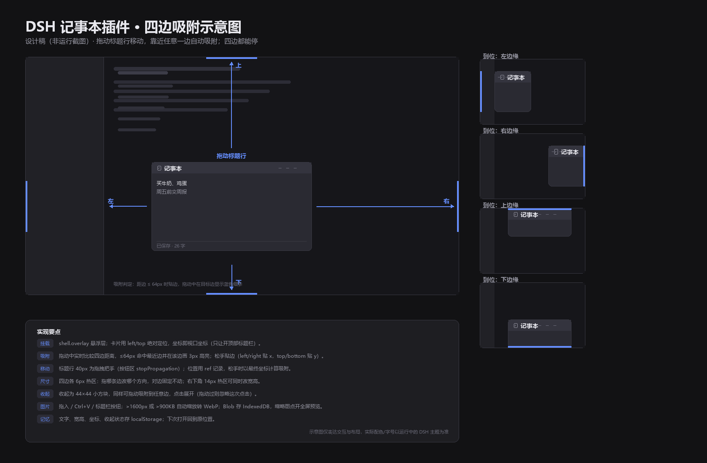

# DSH 记事本插件

`DSH`（DeepSeek Harness）Web 界面上的记事本，**两种摆放模式随时切换，同一个笔记两处共享**：

- **悬浮模式**（默认）：浮动卡片，拖动标题行移动，松手时靠近哪一边就吸附到哪一边——上、下、左、右四边都能停，拖出窗外则收成贴边把手。
- **停靠模式**：挂在框架真实布局的底栏（`shell.bottom`），上方三栏自动变矮，永不遮挡。

两个模式各有切换按钮：悬浮卡片标题栏的「停靠到底部」图标、底栏标题行的「脱离为悬浮卡片」图标。



> 上图为设计示意图，实际配色与字号以运行中的 DSH 主题为准。

## 功能

- **模式开关**：悬浮 ↔ 底部停靠一键切换，文字与图片完全共享，切换时正在进行的内容会先落盘，不会丢。
- **四边自动吸附**：拖动中实时比较到四边的距离，≤64px 时贴边（左/右贴 x，上/下贴 y），边框与圆角随之贴合。
- **自由移动**：标题行 40px 是拖拽把手，面板任意停在画面中间也行；位置随窗口夹紧，不会跑出可视区。
- **四边都能改尺寸**：上/下/左/右四条边各有一条 6px 热区——拖哪条边就改哪个方向，**对边保持不动**（所以拖左边/上边时面板会跟着走）；右下角另有 14px 热区可同时改宽高。260×180 起，上限随窗口自适应。
- **可以拖出窗口外**：把卡片往窗外一带（超出窗口 ≥40px），松手就收成贴着窗口边的一条把手（32px 厚），既不遮挡内容又随时能点回来；窗口内的四边吸附照常保留。
- **可收起**：标题行右上角收起按钮 → 变成 44×44 小方块，小方块本身也能拖动吸附到任意边，点一下展开（拖动过就不会误触展开）。
- **图片**：三个入口——标题栏图片按钮、直接拖进卡片、`Ctrl+V` 粘贴截图。超过 1600px 或 900KB 的自动缩放到 1600px 内并转 WebP。
- **图片查看**：右侧缩略图栏，点开全屏大图预览，`Esc` 或点背景关闭；缩略图右上角小叉删除。
- **自动保存**：文字 250ms 防抖存 `localStorage`，图片 Blob 存 `IndexedDB`（不占 `localStorage` 配额）；底部实时显示「已保存 / 保存中」与字数、图片数。
- **跟随主题**：颜色全部取自 `--dsw-alias-*` 主题变量；文案走 Client locale 服务，中英双语。

## 安装

### 从 GitHub 安装

```sh
dsh plugin --profile desktop add github:879745uhjun/dsh-notepad
```

装好后刷新 Web 页面即可看到卡片。

### 从本地目录安装

在已安装 DSH 的 profile 中用插件管理器安装本目录：

```
plugin_manager install_bundle  target: <本仓库路径>  enabled: true
```

插件会写入 profile 的 `node_modules` 并注册到 `dsh.profile.bundles`。装好后刷新 Web 页面即可看到卡片。

## 结构

| 文件 | 作用 |
| --- | --- |
| `package.json` | 包清单；`dsh.bundle.patch` 指向 `cordis.patch.yml`，`dsh.client` 声明 Web 端注入 |
| `cordis.patch.yml` | 向 profile 组合插入一行 `dsh-notepad` |
| `index.js` | host 半边，空实现（插件只需客户端渲染） |
| `client.js` | 客户端全部逻辑：同时注册 `shell.overlay`（悬浮卡片）与 `shell.bottom`（底部停靠）、共享状态、吸附、拖拽、图片、持久化、样式、locale |
| `locale/zh.json`、`locale/en.json` | Plugin Manager / 设置页读取的插件名称与描述 |
| `icon.svg` | 插件图标 |
| `design-schematic.png` | 本文档顶部的界面示意图 |

## 实现要点

- 两个槽同时注册：`shell.overlay`（悬浮）与 `shell.bottom`（停靠）。两个组件都常驻挂载，只渲染当前模式的那一个；`shell.bottom` 的内容渲染成 `null` 时不占高度（槽说明里写明的行为），所以切到悬浮模式底栏会完全让出空间。
- 文字与图片放在一个模块级 store 里（`subscribe` + `emit`），两处界面共享同一份数据；切模式时先把未落盘的内容同步写一次，避免丢字。
- 挂载在 **`shell.overlay`**：框架唯一的全窗口悬浮层，条目默认可点击（`pointer-events` 由每条自己开启）。
- 坐标直接用视口坐标（`left/top`），只把顶部标题栏那条 `--dsh-frame-chrome-top` 让开，避免压住可拖动窗口的标题栏。
- 吸附判定：`nearestEdge()` 比较四边距离取最近者，`snapTo()` 只改对应那一轴，另一轴保持原位——所以可以贴着上边缘靠右、也可以贴着左边靠下。
- 拖动过程中位置写进 `useRef`，松手时用**最终坐标**判定吸附，避免 React 状态滞后导致的“差一点没吸上”。
- 边缘缩放时记录“对边”坐标（rightEdge/bottomEdge），每帧用 `对边 - 新尺寸` 反推新位置，缩到下限时对边不会漂移。
- 大图预览用 `position: fixed` 覆盖视口，不受卡片尺寸限制。
- 不引入任何 `@deepseek-ai/dsh-client-*` 包，React 由浏览器模块表提供，避免和宿主重复加载。

## 已知限制

- **真正的“浮在窗口外”做不到**：插件渲染的是网页内容，浏览器只能在自身窗口内绘制，框架还用 `overflow:hidden` 裁掉越界部分。要让界面浮在桌面上，得创建独立的原生窗口——那超出插件契约（需要改 DSH 本体）。所以这里提供的是“贴边收成把手”的近似方案：看上去挂在窗外，实际是窗口内最外侧的一条。
- 悬浮卡片会盖住下方内容（这是浮层的固有属性）；放在边缘、收成把手或小方块可把影响降到最小。
- `shell.overlay` 之上还有框架自己的遮罩（例如左侧栏抽屉展开时），那时卡片暂时点不到，关掉抽屉即可。
- `shell.bottom` 是单占位槽；停靠模式下它由本插件占用，若将来官方也往这一行注册内容，两者会互相顶替（后注册者优先）。
- 图片按 Blob 存 IndexedDB，属于浏览器本地数据，不随 DSH profile 迁移。
